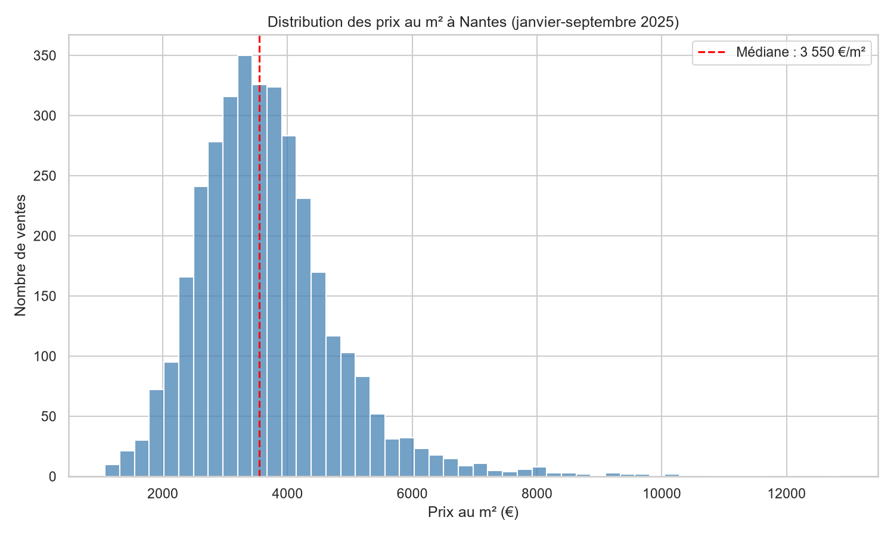
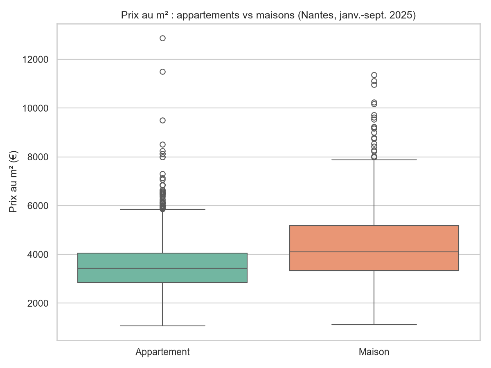
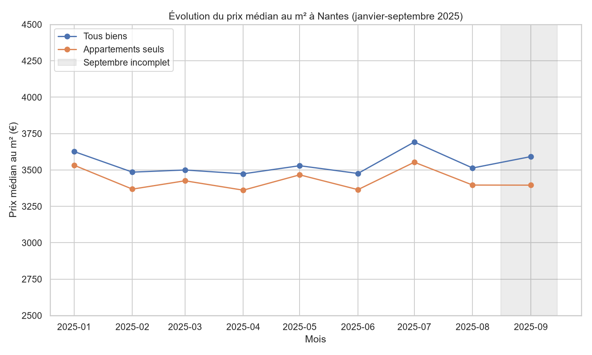
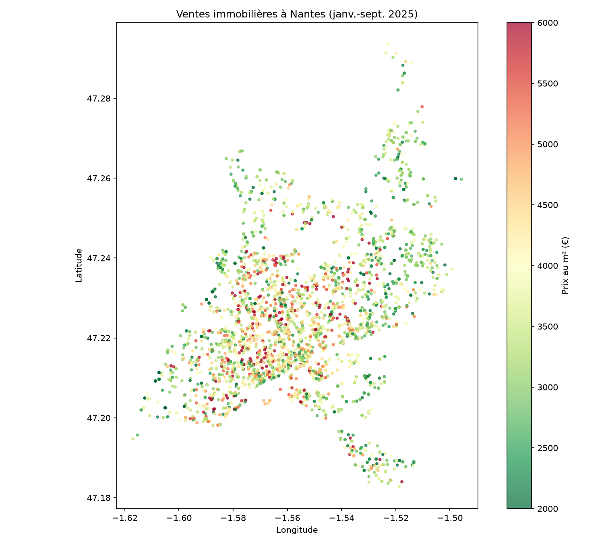
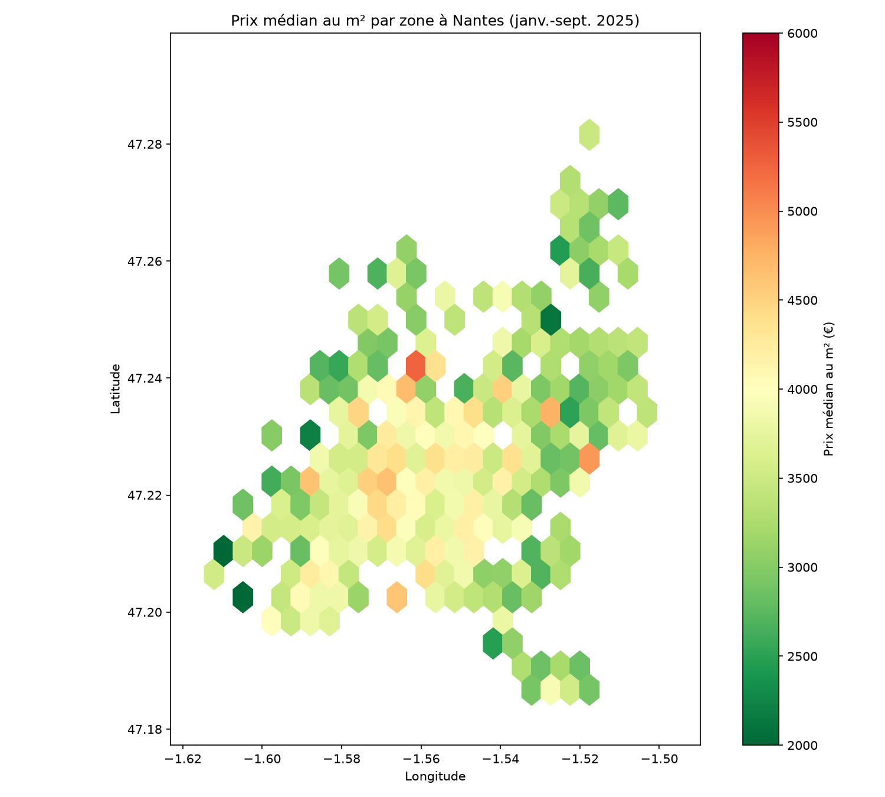

# Analyse du marché immobilier à Nantes (janvier-septembre 2025)

Projet personnel d'analyse de données en Python, à partir des données publiques DVF (Demandes de valeurs foncières).

## Objectif

Comprendre la structure du marché immobilier nantais : niveau des prix au m², différences entre maisons et appartements, évolution dans le temps, écarts entre secteurs et selon la taille des biens.

## Données

- **Source** : DVF géolocalisé, data.gouv.fr
- **Périmètre** : ville de Nantes, ventes du 2 janvier au 26 septembre 2025 (dernières données disponibles ; septembre incomplet)
- **Volume** : 9 516 lignes brutes, 3 453 ventes retenues après nettoyage

## Méthodologie de nettoyage (`nettoyage.py`)

| Étape | Lignes restantes |
|---|---|
| Données brutes | 9 516 |
| Suppression des doublons stricts | 7 498 |
| Ventes uniquement (hors échanges, adjudications…) | 7 469 |
| Prix et surface habitable valides | 4 062 |
| Maisons et appartements uniquement | 3 795 |
| Ventes d'un seul logement (prix non global) | 3 482 |
| Prix au m² entre 1 000 et 15 000 € | **3 453** |

Point clé : une vente peut contenir plusieurs logements avec un prix global répété sur chaque ligne. Ces ventes ont été retirées pour ne pas surestimer les prix au m².

## Résultats clés (`analyse.py`)

- **Prix médian : 3 550 €/m²** (moyenne : 3 677 €/m²). La moitié des ventes se situe entre 2 923 et 4 219 €/m².
- **Prix médian d'un bien : 195 000 €**, pour une surface médiane de 62 m².
- **Maisons vs appartements** : les maisons représentent 20 % des ventes et sont environ 20 % plus chères au m² (4 105 € contre 3 430 €). Une partie de l'écart vient du terrain, inclus dans le prix mais pas dans la surface : les maisons représentent 75 % des valeurs extrêmes.
- **Évolution** : prix stables sur la période, autour de 3 500 €/m², avec des variations mensuelles de quelques pourcents et aucune tendance significative. Résultat confirmé sur les appartements seuls, pour écarter un effet de composition.
- **Secteurs** : le 44000 (centre) est le plus cher, avec environ 3 800 €/m² pour un appartement, soit environ 22 % de plus que le 44300. Le classement reste identique sur les appartements seuls.
- **Carte** : gradient net du centre vers la périphérie.
- **Taille** : le prix au m² des appartements baisse de 1 à 4 pièces (3 849 € pour un studio contre 3 157 € pour un 4 pièces), puis remonte pour les 5 pièces et plus. Une partie de ces écarts s'explique par la localisation : 50 % des studios et 46 % des 5 pièces et plus sont situés en 44000.

## Synthèse

Le marché nantais apparaît **stable** sur les neuf premiers mois de 2025, autour de 3 500 €/m². Les prix sont avant tout structurés par **la localisation**, avec un gradient centre-périphérie, puis par **le type et la taille du bien**. Les écarts observés doivent être lus avec prudence : plusieurs effets se combinent (terrain, localisation, taille), et chaque hypothèse a été vérifiée avec les données plutôt que supposée.

## Limites

- Données partielles : janvier à septembre 2025, septembre incomplet.
- Le prix au m² des maisons inclut le terrain.
- DVF ne renseigne pas l'état du bien (rénovation, vente occupée…).
- Le code postal est un découpage grossier, qui ne correspond pas aux quartiers.
- Une vente de deux logements strictement identiques peut échapper au filtre des ventes groupées.

## Visualisations

## Structure du projet

- `nettoyage.py` : nettoyage des données brutes
- `analyse.py` : statistiques et analyses
- `visualisations.py` : graphiques
- `cartographie.py` : cartes
- `graphiques/` : images produites
- `DVF_Nantes_2025.csv` : données brutes
- `DVF_Nantes_2025_propre.csv` : données nettoyées

## Outils

Python 3.12, pandas, numpy, matplotlib, seaborn, VS Code.

## Prochaines étapes

- Comparer les prix par taille au sein d'un même secteur, pour isoler l'effet de la taille
- Croiser avec les quartiers officiels de Nantes (données ouvertes de Nantes Métropole)
- Carte interactive avec fond de plan (folium)
- Dashboard interactif (Streamlit)
- Étendre l'analyse aux années précédentes pour mesurer une vraie tendance
